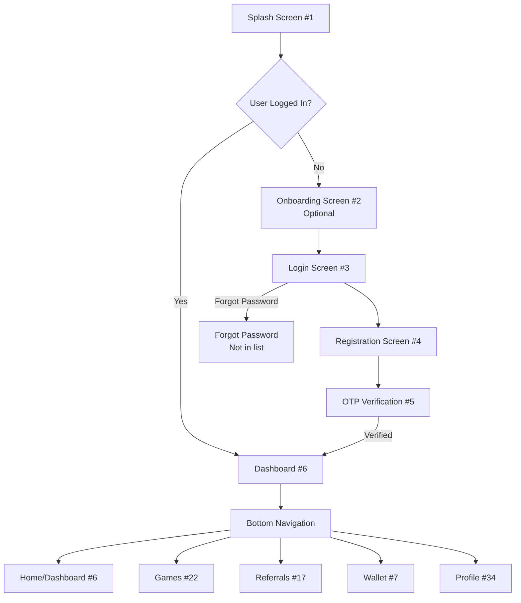
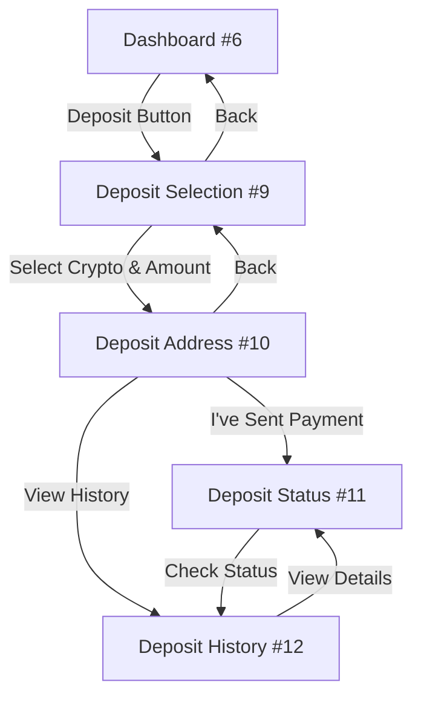
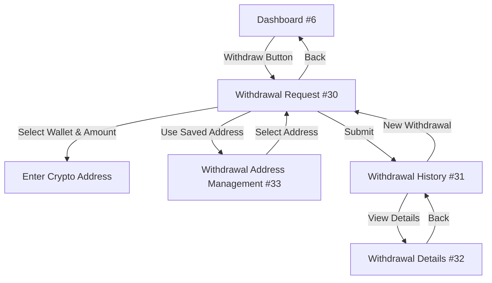
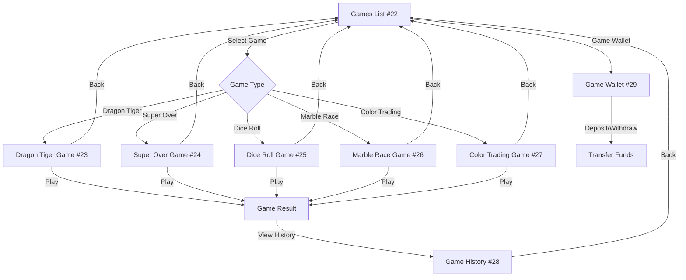
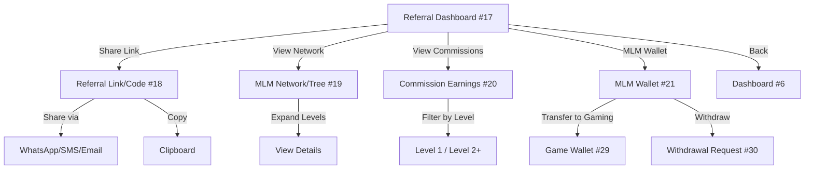
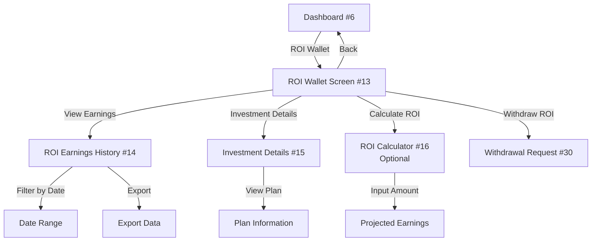
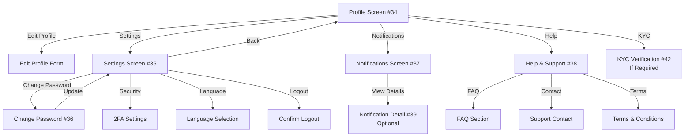
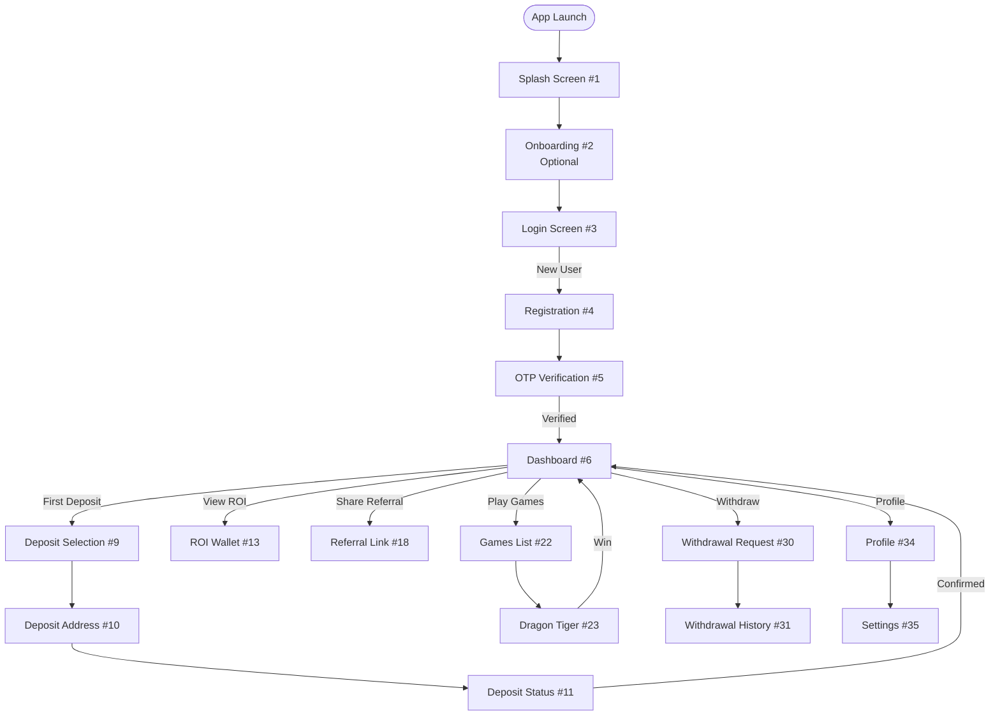
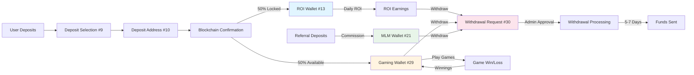

# Mobile App Screens Breakdown

## Total Screens: **~35-40 Screens** (Core + Optional)

---

## 📱 **AUTHENTICATION MODULE** (5 Screens)

### 1. **Splash Screen**
   - App logo, loading animation
   - Check if user is logged in → redirect

### 2. **Onboarding/Welcome Screen** (Optional)
   - App introduction slides
   - Key features overview

### 3. **Login Screen**
   - Email input
   - Password input
   - "Forgot Password?" link
   - "Don't have account? Sign Up" link

### 4. **Registration Screen**
   - Email input
   - Phone number input
   - Optional: Referral code input
   - Terms & conditions checkbox
   - "Sign Up" button

### 5. **OTP Verification Screen**
   - OTP input (6 digits)
   - Resend OTP button
   - Timer countdown
   - Verify button

---

## 🏠 **DASHBOARD & HOME** (3 Screens)

### 6. **Main Dashboard/Home Screen**
   - Wallet balances (ROI, Gaming, MLM)
   - Quick stats (Total ROI earned, Total commissions)
   - Quick actions (Deposit, Withdraw, Play Games)
   - Recent activity feed
   - Navigation bottom bar

### 7. **Wallet Overview Screen**
   - Detailed breakdown of all wallets:
     - ROI Wallet (locked + earnings)
     - Gaming Wallet
     - MLM Commission Wallet
   - Transfer between wallets (if allowed)
   - Transaction history quick link

### 8. **Transaction History Screen**
   - Filter by: All, Deposits, Withdrawals, ROI, MLM, Gaming
   - List of all transactions with:
     - Date & time
     - Type
     - Amount
     - Status
   - Pull to refresh

---

## 💰 **DEPOSIT MODULE** (4 Screens)

### 9. **Deposit Selection Screen**
   - Choose cryptocurrency (USDT, BTC, ETH)
   - Enter amount
   - Minimum deposit warning ($100)
   - Deposit button

### 10. **Deposit Address Screen**
   - QR code for selected crypto
   - Wallet address (copy button)
   - Amount to deposit
   - Network selection (if applicable)
   - "I've sent the payment" button
   - Instructions/help text

### 11. **Deposit Status Screen**
   - Pending deposits list
   - Confirmation status
   - Transaction hash (if available)
   - Estimated confirmation time

### 12. **Deposit History Screen**
   - All past deposits
   - Filter by status (Pending, Confirmed, Failed)
   - Details: Date, Amount, Crypto, Status

---

## 📈 **INVESTMENT/ROI MODULE** (4 Screens)

### 13. **ROI Wallet Screen**
   - Locked balance (principal)
   - ROI earnings balance
   - Daily ROI rate display
   - Monthly ROI rate (8%)
   - Lock-in period countdown (7 days)
   - ROI earnings chart/graph

### 14. **ROI Earnings History Screen**
   - Daily ROI credits
   - Filter by date range
   - Total earnings summary
   - Export option (optional)

### 15. **Investment Details Screen**
   - Active investment plan details
   - Locked amount
   - Start date
   - Lock-in period remaining
   - Total ROI earned
   - Projected earnings

### 16. **ROI Calculator Screen** (Optional)
   - Input: Deposit amount
   - Shows: Daily, Weekly, Monthly ROI
   - Projected earnings over time

---

## 👥 **MLM/REFERRAL MODULE** (5 Screens)

### 17. **Referral Dashboard Screen**
   - Total referrals count
   - Total commission earned
   - Referral link/code (share button)
   - Quick stats (Level 1, Level 2+ commissions)

### 18. **Referral Link/Code Screen**
   - Unique referral code
   - Shareable referral link
   - QR code for referral
   - Share options (WhatsApp, SMS, Email, etc.)
   - Copy to clipboard

### 19. **MLM Network/Tree Screen**
   - Visual tree/graph of referrals
   - Or list view with levels
   - Show: Name, Level, Total deposits, Commission earned
   - Expandable levels

### 20. **Commission Earnings Screen**
   - Commission history
   - Filter by level (Level 1, Level 2+)
   - Filter by date
   - Details: From whom, Amount, Level, Date

### 21. **MLM Wallet Screen**
   - Total MLM balance
   - Available to withdraw
   - Transfer to gaming wallet (if allowed)
   - Commission breakdown by level

---

## 🎮 **GAMING HUB MODULE** (8 Screens)

### 22. **Games List/Home Screen**
   - Grid/list of available games
   - Game icons/thumbnails
   - Game status (Available, Coming Soon)
   - Promo badges (2X rewards indicator)
   - Gaming wallet balance display

### 23. **Dragon Tiger Game Screen**
   - Choose: Dragon or Tiger
   - Place bet amount
   - Game result display
   - Win/loss animation
   - Bet history

### 24. **Super Over Game Screen**
   - Cricket-themed interface
   - Betting options (runs, outcomes)
   - Game simulation
   - Results display
   - Bet history

### 25. **Dice Roll Game Screen**
   - Dice prediction interface
   - Select number/range
   - Place bet
   - Roll animation
   - Results

### 26. **Marble Race Game Screen**
   - Visual marble race
   - Bet on color/position
   - Race animation
   - Results display

### 27. **Color Trading Game Screen**
   - Color prediction interface
   - Pattern selection
   - Bet placement
   - Results

### 28. **Game History Screen**
   - All game bets history
   - Filter by game type
   - Filter by result (Win/Loss)
   - Details: Game, Bet amount, Result, Payout

### 29. **Game Wallet Screen**
   - Available balance
   - Recent game transactions
   - Deposit to game wallet (from ROI/MLM)
   - Withdraw from game wallet

---

## 💸 **WITHDRAWAL MODULE** (4 Screens)

### 30. **Withdrawal Request Screen**
   - Select wallet (ROI, Gaming, MLM)
   - Enter amount
   - Enter crypto address
   - Withdrawal fee display
   - Net amount after fee
   - Submit button

### 31. **Withdrawal History Screen**
   - All withdrawal requests
   - Filter by status (Pending, Approved, Rejected)
   - Filter by wallet type
   - Details: Date, Amount, Fee, Net amount, Status, Remarks

### 32. **Withdrawal Details Screen**
   - Full withdrawal details
   - Status timeline
   - Admin remarks (if rejected)
   - Transaction hash (if approved)
   - Estimated processing time (5-7 days)

### 33. **Withdrawal Address Management Screen** (Optional)
   - Save multiple withdrawal addresses
   - Add/Edit/Delete addresses
   - Label addresses (e.g., "My USDT Wallet")

---

## 👤 **PROFILE & SETTINGS** (5 Screens)

### 34. **Profile Screen**
   - User info (Email, Phone)
   - Profile picture (optional)
   - Account status
   - KYC status (if applicable)
   - Edit profile button

### 35. **Settings Screen**
   - Notifications settings
   - Language selection
   - Security settings (2FA, Change password)
   - About/Help
   - Logout button

### 36. **Change Password Screen**
   - Current password
   - New password
   - Confirm new password
   - Update button

### 37. **Notifications Screen**
   - List of all notifications
   - Mark as read
   - Filter by type
   - Notification settings

### 38. **Help & Support Screen**
   - FAQ section
   - Contact support
   - Terms & Conditions
   - Privacy Policy
   - App version info

---

## 🔔 **NOTIFICATIONS** (1 Screen - Already counted above)

### 39. **Notification Detail Screen** (Optional)
   - Full notification content
   - Action buttons (if applicable)

---

## 📊 **ADDITIONAL/OPTIONAL SCREENS** (2-3 Screens)

### 40. **Statistics/Analytics Screen** (Optional)
   - Charts and graphs
   - ROI trends
   - Commission trends
   - Gaming performance

### 41. **Promotions/Offers Screen** (Optional)
   - Active promotions
   - 2X game rewards info
   - Special offers

### 42. **KYC Verification Screen** (If required)
   - Document upload
   - Verification status
   - Instructions

---

## 📋 **SUMMARY BY MODULE**

| Module | Screen Count |
|--------|-------------|
| Authentication | 5 |
| Dashboard & Home | 3 |
| Deposit | 4 |
| Investment/ROI | 4 |
| MLM/Referral | 5 |
| Gaming Hub | 8 |
| Withdrawal | 4 |
| Profile & Settings | 5 |
| Optional/Additional | 2-3 |
| **TOTAL** | **40-42 Screens** |

---

## 🎯 **PRIORITY BREAKDOWN**

### **Phase 1 - MVP (Must Have): ~25 Screens**
- All Authentication (5)
- Dashboard & Home (3)
- Deposit (4)
- ROI Basic (2)
- MLM Basic (3)
- Gaming Basic (4)
- Withdrawal (3)
- Profile Basic (2)

### **Phase 2 - Enhanced Features: +10 Screens**
- ROI Advanced (2)
- MLM Advanced (2)
- Gaming Advanced (4)
- Profile Advanced (2)

### **Phase 3 - Nice to Have: +5 Screens**
- Analytics
- Promotions
- KYC
- Advanced features

---

## 💡 **DESIGN NOTES**

1. **Bottom Navigation Bar** (Main screens):
   - Home/Dashboard
   - Games
   - Referrals
   - Wallet
   - Profile

2. **Common UI Components Needed**:
   - Wallet balance cards
   - Transaction list items
   - Game cards
   - Status badges (Pending, Approved, etc.)
   - Loading states
   - Empty states

3. **Key User Flows**:
   - Registration → OTP → Dashboard
   - Deposit → Address → Confirmation
   - Play Game → Bet → Result
   - Withdraw → Request → Status
   - Share Referral → Track Network

---

## ✅ **RECOMMENDATION**

**Start with 25-30 core screens** for MVP, then add the remaining screens based on user feedback and priorities.

---

## 📝 **COMPLETE SCREEN LIST (All 42 Screens)**

### **AUTHENTICATION MODULE** (5 Screens)
1. Splash Screen
2. Onboarding/Welcome Screen (Optional)
3. Login Screen
4. Registration Screen
5. OTP Verification Screen

### **DASHBOARD & HOME** (3 Screens)
6. Main Dashboard/Home Screen
7. Wallet Overview Screen
8. Transaction History Screen

### **DEPOSIT MODULE** (4 Screens)
9. Deposit Selection Screen
10. Deposit Address Screen
11. Deposit Status Screen
12. Deposit History Screen

### **INVESTMENT/ROI MODULE** (4 Screens)
13. ROI Wallet Screen
14. ROI Earnings History Screen
15. Investment Details Screen
16. ROI Calculator Screen (Optional)

### **MLM/REFERRAL MODULE** (5 Screens)
17. Referral Dashboard Screen
18. Referral Link/Code Screen
19. MLM Network/Tree Screen
20. Commission Earnings Screen
21. MLM Wallet Screen

### **GAMING HUB MODULE** (8 Screens)
22. Games List/Home Screen
23. Dragon Tiger Game Screen
24. Super Over Game Screen
25. Dice Roll Game Screen
26. Marble Race Game Screen
27. Color Trading Game Screen
28. Game History Screen
29. Game Wallet Screen

### **WITHDRAWAL MODULE** (4 Screens)
30. Withdrawal Request Screen
31. Withdrawal History Screen
32. Withdrawal Details Screen
33. Withdrawal Address Management Screen (Optional)

### **PROFILE & SETTINGS** (5 Screens)
34. Profile Screen
35. Settings Screen
36. Change Password Screen
37. Notifications Screen
38. Help & Support Screen

### **ADDITIONAL/OPTIONAL SCREENS** (4 Screens)
39. Notification Detail Screen (Optional)
40. Statistics/Analytics Screen (Optional)
41. Promotions/Offers Screen (Optional)
42. KYC Verification Screen (If required)

---

## 🎯 **QUICK REFERENCE BY NUMBER**

**Core Screens (1-38):** 38 screens
**Optional Screens (39-42):** 4 screens
**Total: 42 Screens**

---

## 🔄 **SCREEN FLOW DIAGRAMS**

### **1. Main App Flow (Authentication → Dashboard)**

### **2. Deposit Flow**

### **3. Withdrawal Flow**

### **4. Gaming Hub Flow**

### **5. MLM/Referral Flow**

### **6. ROI/Investment Flow**

### **7. Profile & Settings Flow**

### **8. Complete Navigation Structure**

```mermaid
flowchart TB
    subgraph "Bottom Navigation"
        A[Dashboard #6]
        B[Games List #22]
        C[Referral Dashboard #17]
        D[Wallet Overview #7]
        E[Profile #34]
    end
    
    subgraph "Dashboard Access"
        A --> F[Deposit #9]
        A --> G[Withdraw #30]
        A --> H[ROI Wallet #13]
        A --> I[Transaction History #8]
    end
    
    subgraph "Games Access"
        B --> J[Dragon Tiger #23]
        B --> K[Super Over #24]
        B --> L[Dice Roll #25]
        B --> M[Marble Race #26]
        B --> N[Color Trading #27]
        B --> O[Game History #28]
        B --> P[Game Wallet #29]
    end
    
    subgraph "Referral Access"
        C --> Q[Referral Link #18]
        C --> R[MLM Network #19]
        C --> S[Commission Earnings #20]
        C --> T[MLM Wallet #21]
    end
    
    subgraph "Wallet Access"
        D --> U[ROI Wallet #13]
        D --> V[Gaming Wallet #29]
        D --> W[MLM Wallet #21]
        D --> I
    end
    
    subgraph "Profile Access"
        E --> X[Settings #35]
        E --> Y[Notifications #37]
        E --> Z[Help & Support #38]
        E --> AA[Change Password #36]
    end
```

### **9. User Journey Flow (New User)**

### **10. Transaction Flow (Complete Cycle)**

---

## 📱 **NAVIGATION PATTERNS**

### **Bottom Tab Navigation (Always Visible)**
- **Home** → Dashboard #6
- **Games** → Games List #22
- **Referrals** → Referral Dashboard #17
- **Wallet** → Wallet Overview #7
- **Profile** → Profile Screen #34

### **Back Navigation**
- All screens have back button (except bottom tab screens)
- Modal screens can be dismissed
- Deep links can navigate directly to specific screens

### **Quick Actions (From Dashboard)**
- Deposit → Screen #9
- Withdraw → Screen #30
- Play Games → Screen #22
- View ROI → Screen #13
- Share Referral → Screen #18

---

## 🔗 **KEY USER FLOWS SUMMARY**

1. **Registration Flow**: Splash → Onboarding → Login → Register → OTP → Dashboard
2. **Deposit Flow**: Dashboard → Deposit Selection → Deposit Address → Deposit Status
3. **Gaming Flow**: Games List → Select Game → Play → Result → Game History
4. **Withdrawal Flow**: Dashboard → Withdrawal Request → Withdrawal History → Details
5. **Referral Flow**: Referral Dashboard → Share Link → Track Network → View Commissions
6. **ROI Flow**: Dashboard → ROI Wallet → Earnings History → Investment Details

